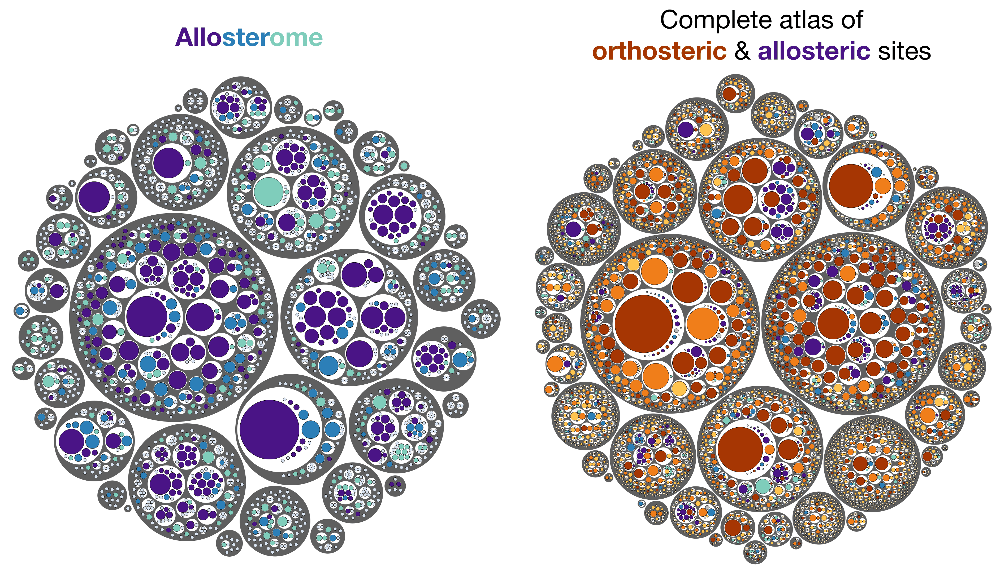
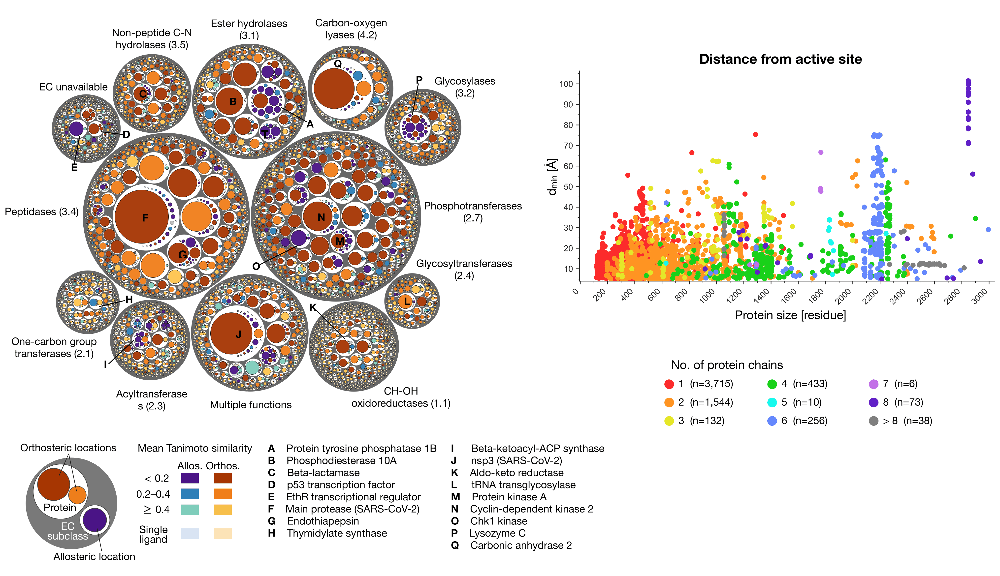
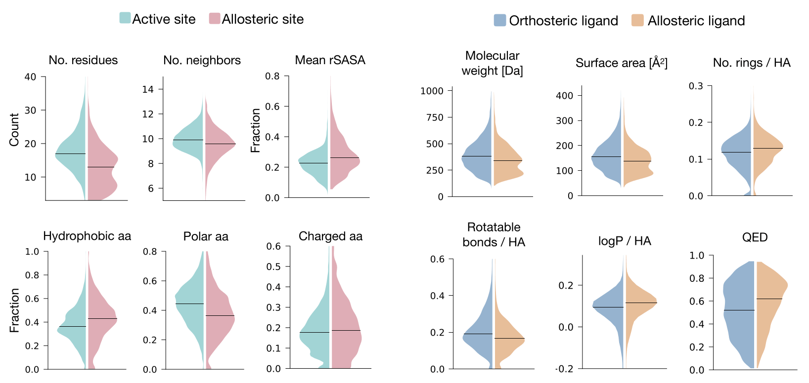

# The **R**epository for **O**rthosteric and **A**llosteric **D**esign (**ROAD**)

## ROAD
<br><br>

|  | Allosteric site | Orthosteric site |
|---|---|---|
| Count | 6,207 | 20,957 |
| No. of PDB structures with | 5,224 | 19,387 |
| No. of proteins with | 1,136 | 3,489 |
| No. of ligands bound to | 4,139 | 14,570 |    

  As of 2026; v1.0.0

<br>
ROAD is a comprehensive database featuring high-quality, non-redundant sets of allosteric and functional (orthosteric) sites and ligands, systematically identified from 128,141 PDB structures. All data, alongside the construction and analysis pipelines, are freely available here. We anticipate that ROAD will pave the way for developing and benchmarking methods in allosteric site prediction, rational design of allosteric and orthosteric ligands, and engineering of allosteric mechanisms in proteins. The manuscript describing ROAD is available at TODO.
The figure above illustrates the full distribution of site-ligand data in ROAD across individual proteins and enzymatic functions.
<br clear="left"><br><br>



<br> The left figure depicts the distribution of allosteric and active sites across the largest functional clusters. First, proteins were grouped by EC subclass (grey circles). To define ligand-binding locations within individual proteins (white circles), binding sites from all corresponding crystal structures were mapped onto the protein sequence. Sites with identical or substantially overlapping residues were then clustered into distinct locations (colored circles). Mean pairwise ligand similarity (ECFP4 Tanimoto) per location is indicated by red–orange (allosteric) and purple–blue (orthosteric) color scales. On the right, the minimum distance to an active site residue (dmin, Å) is plotted against total chain length for each allosteric site, colored by oligomeric state.

Below: Characterization of allosteric/orthosteric sites (left) and ligands (right). See the paper TODO for more details.

<br clear="left">


## Table of Contents

- [ROAD](#road)
- [Repository layout](#repository-layout)
- [Environment](#environment)
- [Collection module](#collection-module)
   - [Prerequisites - collection](#prerequisites-for-the-collection-pipeline)
   - [Setting up collection](#setting-up-collection)
   - [Running collection](#running-collection)
- [Analysis module](#analysis-module)
   - [Prerequisites - analysis](#prerequisites-for-the-analysis-pipeline)
   - [Running analysis](#running-analysis)
- [Citation](#citation)
- [Publications](#publications)
- [License](#license)


## Repository layout
`ROAD_DATA/` contains all computed final data (.csv) of the database that can be used directly, excluding the PDB structures (~6 GB) containing the allosteric/orthosteric sites, which can be downloaded from Zenodo at https://doi.org/10.5281/zenodo.21901988 or click this button [](https://doi.org/10.5281/zenodo.21901988)  

| Filename | Description |
|---|---|
| `nonredundant_sites_annotated_enriched.csv` | Data on protein structures, allosteric and orthosteric binding sites and ligand names.  Result from the Collection module|
| `nonredundant_sites_annotated_enriched_fields.txt` | Description for the file above |
| `site_ligand_features.csv` | Data on characteristics of binding sites, ligands and site-ligand interactions. Result from the Analysis module |
| `site_ligand_features_fields.txt` | Description for the file above | 
| `clusters_foldseek_all.csv` | Foldseek clustering result for all protein structures | 
| `clusters_foldseek_allosteric.csv` | Foldseek clustering result for structures containing an allosteric site | 
| `clusters_foldseek_fields.txt` | Description for the files above |
| `hierarchy.csv` | Binding sites grouped as EC subclass > protein > location (sites sharing residues) |
| `hierarchy_fields.txt` | Description for the file above |
| `PDB.tar.gz` (Zenodo) | Directory of PDB structure files (~4 GB). Download from Zenodo [](https://doi.org/10.5281/zenodo.21901988) |
| `PDB_allosteric.tar.gz` (Zenodo) | Directory of PDB structure files (~1 GB). Download from Zenodo. | 
<br>

To build a custom database starting from a set of PDB structures:<br>
`Collection/` builds the datasets of allosteric and orthosteric/active sites and ligands.  
`Analysis/` compute the characteristics of binding sites, ligands, and site-ligand interactions.  
     
<br>

## Environment
Create the conda environment and install the required packages:
```bash
conda env create -f environment.yml   # collection + analysis
conda activate ROAD-database
```
<br>

## Collection module
Key steps in this module:
- identifies functional sites annotated by UniProt
- extracts binding sites bound by small molecules with biological roles
- annotates and calculates the distance between binding sites and functional sites
- performs de-duplication of similar site-ligand pairs to yield non-redundant sets  

<br>
An operational definition of allosteric sites is applied here, a ligand-binding site is considered allosteric if the shortest distance atom-atom distance between any functional site residue (e.g. active site and DNA-binding site) and any binding site residue exceeds 5 Å. Otherwise, the ligand is considered orthosteric, i.e. binding to the functional/active site of the protein.  
<br><br>
  
**The main output from this module is already processed and provided in `ROAD_DATA/nonredundant_sites_annotated_enriched.csv`. When ran, the pipeline generates it in gitignored `collection/result/nonredundant/`** 
  
See the note in `ROAD_DATA/` on description of the data

<br>

### Prerequisites for the Collection pipeline
1. PDB assembly CIF files
   - The list of 128,141 PDB codes used here is provided at `collection/data/downloaded_PDB_{1,2}.txt`, which may be used to download the structures from the PDB in `{PDB_ID}-assembly1.cif` format if one wishes .
   - See [Setting up Collection](#setting-up-collection) below for how to point the pipeline at your local copy.

2. wwPDB Chemical Component Dictionary (CCD)
   - Download **Chemical Component Dictionary: mmCIF (gz)** (~500 MB) from <https://www.wwpdb.org/data/ccd>
   - Unzip and have the file as `collection/data/Components-rel-alt.cif`

3. BioLiP artifact list
   - Already included at `collection/data/possible_artifact_molecule_list.txt`, contains list of ligands that are likely experimental additives/buffers

<br>

### Setting up Collection

`collection/src/config.py` needs a directory of PDB assembly CIF files, two ways to set it, either:
```bash
export STRUCTURE_CIF_DIR=/path/to/your/PDB/assembly/cifs/
```
or copy `collection/src/config_local.py.example` to a gitignored `collection/src/config_local.py`:

```bash
cp collection/src/config_local.py.example collection/src/config_local.py
# then edit CIF_DIR in collection/src/config_local.py
```

<br>

### Running Collection
```bash
python run_collection_pipeline.py                                     # full run, all steps
python run_collection_pipeline.py --h                                 # list stages and options
python run_collection_pipeline.py --steps site_extraction site_filter # run specific steps only
python run_collection_pipeline.py --verbose                           # verbose
python run_collection_pipeline.py --force                             # force re-run, ignore cached outputs
```
A step is skipped when all of its outputs already exist; pass `-f`/`--force` to
recompute. `--force` also clears the caches. 

<br>

## Analysis module
This module analyses characteristics of allosteric and orthosteric sites (e.g. amino-acid composition, geometry, and more), ligands (topological, physicochemical properties, and more), as well as site-ligand interactions. It uses the output produced by the `../collection` module.

**The main output from this module is already computed and provided in `ROAD_DATA/site_ligand_features.csv`. When ran, the pipeline generates it in gitignored `analysis/data/`**  

See the note in `ROAD_DATA/` on description of the data

<br>

### Prerequisites for the Analysis pipeline
- This sibling module requires that the user to have successfully run the collection pipeline `../collection/` using a local copy of PDB files, as it reads the multiple files obtained in the collection pipeline.  
- Copy the main collection output into `analysis/input_dataset/`  
   ```bash
   mkdir -p input_dataset
   cp ../collection/result/nonredundant/nonredundant_sites_annotated_enriched.csv input_dataset/
   ```
- Copy the Chemical Component Dictionary file in the collection module and place it here 
`analysis/ccd/Components-rel-alt.cif`.  
- FreeSASA, Foldseek, pdbe-arpeggio and RDKit should be installed. See `environment.yml`.

<br>

### Running Analysis

```bash
python run_analysis_pipeline.py                           # full run, all stages
python run_analysis_pipeline.py --help                    # list stages and options
python run_analysis_pipeline.py --verbose                 # full run, verbose
python run_analysis_pipeline.py --only smiles descriptors # run specific stages plus their dependencies
python run_analysis_pipeline.py --force                   # force re-run
```

<br>

## Citation
*TODO*
See `CITATION.txt`.

<br>

## Publications
#### Allosteric drugs and their design  
[Allosteric solution to the problems of undruggable targets, drug toxicity, and emerging resistance](https://www.sciencedirect.com/science/article/pii/S0959440X25001903)

[Toward the Design of Allosteric Effectors: Gaining Comprehensive Control of Drug Properties and Actions](https://pubs.acs.org/jmcmar/article/67/19/17191/194495/Toward-the-Design-of-Allosteric-Effectors-Gaining)

[Allosteric drugs: New principles and design approaches](https://www.sciencedirect.com/science/article/abs/pii/S0959440X23002324)

[Designing Structure-specific and Switchable Allosteric Effectors for GPCRs Based on the Causality and Energetics of Inherent Signaling](https://www.sciencedirect.com/science/article/pii/S0022283625003596)    

#### Allosteric effects of mutations and their applications for protein design
[On the relationship between protein stability, thermostability, and allosteric signaling](https://www.sciencedirect.com/science/article/pii/S0022283625006035?via%3Dihub)

[Conservation and diversity in allosteric fingerprints of proteins for evolutionary-inspired engineering and design](https://www.sciencedirect.com/science/article/abs/pii/S0022283622001577?via%3Dihub)

[On the Allosteric Effect of nsSNPs and the Emerging Importance of Allosteric Polymorphism](https://www.sciencedirect.com/science/article/abs/pii/S0022283619304413?via%3Dihub)

#### Structure-Based Statistical Mechanical Model of Allostery (SBSMMA)  
[Structure-Based Statistical Mechanical Model Accounts for the Causality and Energetics of Allosteric Communication](https://journals.plos.org/ploscompbiol/article?id=10.1371/journal.pcbi.1004678)    

[Toward Comprehensive Allosteric Control over Protein Activity](https://www.sciencedirect.com/science/article/pii/S0969212619300140)

#### The AlloSigMA web-server and AlloMAPS database  
[AlloSigMA 2: paving the way to designing allosteric effectors and to exploring allosteric effects of mutations](https://academic.oup.com/nar/article/48/W1/W116/5835812) [[server link](https://allosigma.bii.a-star.edu.sg/home/)]

[AlloMAPS 2: allosteric fingerprints of the AlphaFold and Pfam-trRosetta predicted structures for engineering and design](https://academic.oup.com/nar/article/51/D1/D345/6725768) [[database link](https://allomaps.bii.a-star.edu.sg)]

<br>

## License

Copyright (C) 2026 Wei-Ven Tee

GNU General Public License v3.0 — see `LICENSE`.
